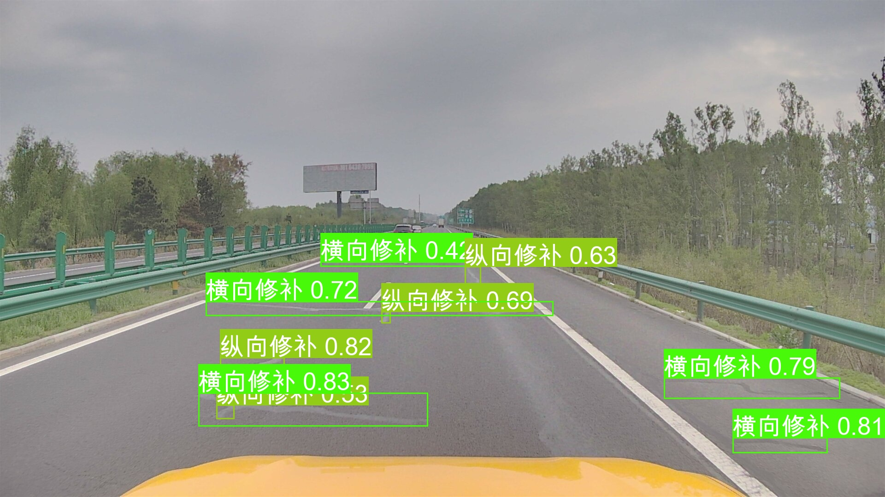
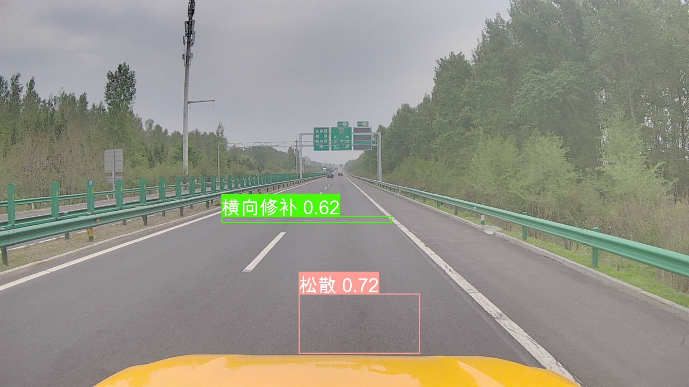

<div align="center">

# 道路病害智能检测系统

**基于 YOLOv5 v7.0 的路面 18 类病害检测 · 训练 + 桌面端 + Web 端 + 监控大屏一体化方案**

[](#)
[](https://pytorch.org/)
[](https://github.com/ultralytics/yolov5)
[](#)
[](LICENSE)

简体中文 | [English](README_en.md)

</div>

---

本项目基于 [Ultralytics YOLOv5 v7.0](https://github.com/ultralytics/yolov5) 框架，在 **5965 张真实行车视角路面图像**上微调，实现对路面 **18 类病害及目标**（坑槽、裂缝、修补、标线模糊、抛洒物、交通桶等）的自动检测，并提供三套可直接运行的应用端。仓库内置训练好的模型权重，克隆后即可推理。

> 本 README 面向 YOLOv5 初学者：从环境搭建、数据标注转换、训练，到运行完整检测系统，全流程可照做复现。

---

## 检测效果展示

真实行车记录仪路面图像，由仓库内置权重 `weights/best_fixed.pt` 输出（输入 640，RTX 4060 单帧推理约 68 ms）。

| 多目标修补区域检测（同屏 9 处病害） | 远距离小目标检测（横向修补带 + 松散） |
|:---:|:---:|
|  |  |

> 复现：`python detect.py --weights weights/best_fixed.pt --source 图片路径`（详见 [推理](#模型推理)）

---

## 目录

- [主要特性](#主要特性)
- [项目结构](#项目结构)
- [检测类别](#检测类别)
- [环境安装](#环境安装)
- [快速体验](#快速体验)
- [数据集准备（labelme → YOLO）](#数据集准备labelme--yolo)
- [模型训练](#模型训练)
- [模型验证与指标解读](#模型验证与指标解读)
- [模型推理](#模型推理)
- [启动检测系统](#启动检测系统)
- [模型导出与部署](#模型导出与部署)
- [常见问题 FAQ](#常见问题-faq)
- [致谢与许可证](#致谢与许可证)

---

## 主要特性

- **18 类道路病害体系**：覆盖病害（坑槽/裂缝/松散）、修补痕迹、标线状态与路面异物/目标，可直接用于路况巡检业务
- **开箱即用的权重**：`weights/best_fixed.pt` 已内置并修复中文类别名，克隆即可检测
- **完整数据管线**：`json2yolo.py` 一键将 labelme 标注转换为 YOLO 格式；分层随机划分 train/valid/test
- **三套应用端**：PyQt5 桌面检测系统、Flask Web 检测服务、监控大屏客户端
- **初学者友好**：全流程命令、参数逐项解释、FAQ 覆盖常见报错

## 项目结构

```
YOLOv5-Pavement-Detection/
├── train.py                  # 训练入口脚本（YOLOv5 官方）
├── val.py                    # 验证/评估入口脚本（YOLOv5 官方）
├── detect.py                 # 推理入口脚本（YOLOv5 官方）
├── export.py                 # 模型导出脚本（ONNX/TensorRT 等）
├── hubconf.py                # torch.hub 推理入口（Python 代码中 torch.hub.load 依赖它）
├── requirements.txt          # Python 依赖清单
├── highway_data.yaml         # 本项目的数据集配置文件（训练时指向它）
├── json2yolo.py              # labelme 标注 json → YOLO txt 转换工具
├── zhiti.py                  # 权重类别名修复工具（见 FAQ）
│
├── models/                   # 模型结构定义
│   ├── yolov5s.yaml          #   s/n/m/l/x 五种网络深度配置
│   ├── yolo.py               #   网络搭建代码
│   └── experimental.py       #   attempt_load 等加载工具
│
├── utils/                    # 工具库（数据处理、损失、指标、绘图等）
│   ├── dataloaders.py        #   数据集读取
│   ├── metrics.py            #   mAP/P/R 计算
│   └── plots.py              #   结果可视化
│
├── weights/
│   └── best_fixed.pt         # 训练好的道路病害模型（已修复中文类别名）
├── docs/                     # README 展示用检测效果图
│
├── road_disease_pyqt_main.py # 【系统A】PyQt5 桌面检测主程序
├── win1.py                   #   桌面版 UI 界面定义
├── app.py                    # 【系统B】Flask Web 检测服务
├── templates/
│   └── index.html            #   Web 前端页面（Flask 固定从 templates/ 读取）
└── pyqt_client.py            # 【系统C】监控大屏客户端
```

**初学者理解要点**

- `train.py / val.py / detect.py / export.py` 是 YOLOv5 的四个"总入口"，分别对应：训练、评估、推理、部署导出
- `models/` 决定"网络长什么样"，`utils/` 决定"数据怎么喂、损失怎么算"，一般不需要改动
- 训练产物默认输出到 `runs/train/exp*/`，本仓库不包含 runs，需自行训练生成

## 检测类别

共 **18 类**，类别编号与 `highway_data.yaml` 一致：

| ID | 类别 | ID | 类别 | ID | 类别 |
|:--:|------|:--:|------|:--:|------|
| 0 | 坑槽 | 6 | 纵向修补 | 12 | 圆形桶 |
| 1 | 松散 | 7 | 块状修补 | 13 | 人 |
| 2 | 横向裂纹 | 8 | 网状修补 | 14 | 方形雨水盖 |
| 3 | 纵向裂纹 | 9 | 标线模糊 | 15 | 圆形雨水盖 |
| 4 | 网状裂纹 | 10 | 抛洒物 | 16 | 圆形井盖 |
| 5 | 横向修补 | 11 | 锥形桶 | 17 | 护栏损坏 |

## 环境安装

**推荐配置**：Windows + Python 3.8~3.11 + CUDA 11.x/12.x（NVIDIA 显卡）；无显卡也可用 CPU 推理（较慢）。

```bash
# 1. 创建虚拟环境（conda 为例）
conda create -n yolov5 python=3.9 -y
conda activate yolov5

# 2. 安装依赖
pip install -r requirements.txt

# 3. （可选，有 NVIDIA 显卡时）安装 GPU 版 PyTorch，以 CUDA 11.8 为例
pip install torch==2.0.1 torchvision==0.15.2 --index-url https://download.pytorch.org/whl/cu118
```

验证安装：

```bash
python -c "import torch; print(torch.__version__, torch.cuda.is_available())"
```

> 国内下载慢可换源：`pip install -r requirements.txt -i https://pypi.tuna.tsinghua.edu.cn/simple`

## 快速体验

仓库自带训练好的权重，装完环境即可直接检测：

```bash
python detect.py --weights weights/best_fixed.pt --source 你的路面图片.jpg
```

检测结果（带中文标注框的图片）保存在 `runs/detect/exp*/`。

## 数据集准备（labelme → YOLO）

YOLOv5 要求的数据集结构：

```
highway_label/
├── train/
│   ├── images/   # 训练图片 .jpg
│   └── labels/   # 同名 YOLO 标注 .txt
├── valid/
│   ├── images/
│   └── labels/
└── jsons/        # labelme 原始标注（仅存档，训练不用）
```

**YOLO 标注格式**（每行一个目标）：`类别id 中心x 中心y 宽w 高h`，四个值全部是相对图片宽高的归一化小数（0~1）。

**转换步骤**：

1. 用 [labelme](https://github.com/wkentaro/labelme) 标注图片，每张图生成同名 `.json`，放入 `highway_label/jsons/`
2. 打开 `json2yolo.py`，确认顶部 `name2id` 字典包含你 json 里的全部类别名（本项目已配好 18 类，并内置笔误别名合并：`纵向裂缝` → `纵向裂纹`）
3. 运行转换：

```bash
python json2yolo.py
# 输出到 highway_label/labels/，与 images 一一对应
```

4. 划分 train/valid/test 时建议**分层随机划分**（保证稀有类别进入训练集），比例参考 8:1:1

`highway_data.yaml` 已写好路径（相对本仓库根目录），如果你的数据集不在 `../highway_label`，修改以下两行即可：

```yaml
train: ../highway_label/train/images
val:   ../highway_label/valid/images
nc: 18
names: ['坑槽','松散', ...]
```

## 模型训练

### 下载预训练权重

从零训练收敛慢，通常加载官方预训练权重 `yolov5s.pt`（约 14 MB）微调。首次运行 `train.py --weights yolov5s.pt` 会自动下载到当前目录；也可从 [Releases](https://github.com/ultralytics/yolov5/releases/tag/v7.0) 手动下载，放到与 `--weights` 参数一致的路径即可。

### 开始训练

```bash
python train.py --data highway_data.yaml --weights yolov5s.pt --epochs 100 --batch-size 16 --img 640
```

**参数解释（初学者必看）**：

| 参数 | 含义 |
|------|------|
| `--data` | 数据集配置文件，指向 `highway_data.yaml` |
| `--weights` | 加载的预训练权重；传 `yolov5s.pt` 是微调，传 `''` 是从零训练 |
| `--cfg` | 网络结构 yaml；配合 `--weights '' --cfg models/yolov5s.yaml` 才是完整从零训练写法 |
| `--epochs` | 训练轮数，数据量几千张建议 100~300 |
| `--batch-size` | 每批图片数，显存 8G 建议 16，16G 可 32；爆显存就调小 |
| `--img` | 输入尺寸 640，小目标多可改 1280（显存占用约 4 倍） |
| `--device` | `0` 用第一块显卡；`cpu` 强制 CPU |
| `--name` | 实验名，输出到 `runs/train/<name>/` |

### 观察训练过程

- 终端实时打印每轮损失（box/obj/cls）和 P/R/mAP
- TensorBoard：`tensorboard --logdir runs/train`，浏览器打开 `http://localhost:6006`
- 训练结束后取 `runs/train/exp*/weights/best.pt`（验证集表现最好）与 `last.pt`（最后一轮）

### 中断续训 / 追加训练

```bash
python train.py --resume        # 继续上一次中断的训练
python train.py --weights runs/train/exp/weights/last.pt --epochs 200  # 在旧模型上继续训练
```

## 模型验证与指标解读

```bash
python val.py --data highway_data.yaml --weights weights/best_fixed.pt --img 640
```

| 指标 | 含义 |
|------|------|
| **P（精确率）** | 检出的目标里有多少是真的（越高误报越少） |
| **R（召回率）** | 真实目标里有多少被检出（越高漏检越少） |
| **mAP@0.5** | IoU 阈值 0.5 下的平均精度，常用总体指标 |
| **mAP@0.5:0.95** | 更严格的综合指标，论文/对比常用 |

还会生成混淆矩阵、PR 曲线、各分类指标，保存在 `runs/val/exp*/`。

## 模型推理

命令行推理（图片/视频/摄像头均可）：

```bash
python detect.py --weights weights/best_fixed.pt --source 测试图片.jpg
python detect.py --weights weights/best_fixed.pt --source 0        # 摄像头实时检测
```

Python 代码推理（最简模板）：

```python
import torch
model = torch.hub.load('./', 'custom', path='weights/best_fixed.pt', source='local')
model.conf = 0.35   # 置信度阈值
results = model(['test.jpg'])
results.print(); results.save()
```

## 启动检测系统

三套系统都加载 `weights/best_fixed.pt`，**请在仓库根目录下运行**（代码按相对路径找模型）。

### 系统 A：PyQt5 桌面版

```bash
pip install PyQt5
python road_disease_pyqt_main.py
```

打开窗口后选择本地图片，点击检测即可在界面上看到病害标注框。

### 系统 B：Flask Web 服务

```bash
pip install flask flask-cors
python app.py
# 浏览器访问 http://127.0.0.1:5000
```

网页上传图片 → 服务端推理 → 返回带框结果图。

### 系统 C：监控大屏客户端

```bash
python pyqt_client.py
```

独立推理大屏，与 Web 服务通过 `shared_results/` 目录共享检测结果图片。

> 中文标注绘制依赖 Windows 字体 `C:/Windows/Fonts/msyh.ttc`（微软雅黑），在 Windows 上无需处理；其他系统需自行改字体路径。

## 模型导出与部署

```bash
python export.py --weights weights/best_fixed.pt --include onnx    # 导出 ONNX
python export.py --weights weights/best_fixed.pt --include engine --device 0  # TensorRT
```

导出后可脱离 PyTorch，在 C++/服务端等环境用 ONNX Runtime 部署。

## 常见问题 FAQ

**Q1：训练完的模型类别名变成英文/数字，推理时不显示中文怎么办？**
A：YOLOv5 保存权重时类别名可能丢失。运行 `python zhiti.py`：把脚本里的 `model_path` 指向你的 `best.pt`，它会按本项目 18 类中文名重新写入并保存为 `weights/best_fixed.pt`。

**Q2：报错 `Label image size mismatch` 或找不到标签？**
A：检查 `images/` 与 `labels/` 文件名是否一一对应（同名不同后缀）、图片是否损坏、json 转换时 `imageWidth/imageHeight` 是否与实际图片一致。

**Q3：报错 CUDA out of memory？**
A：调小 `--batch-size`，或调小 `--img`；也可 `--device cpu` 先跑通流程。

**Q4：`--data` 路径怎么写？**
A：相对路径基于数据集 yaml 所在目录解析。本仓库 `highway_data.yaml` 中 `../highway_label/train/images` 指向与本仓库同级的 `highway_label` 文件夹，位置不同请自行修改。

**Q5：首次运行卡在下载 yolov5s.pt？**
A：手动从 [v7.0 Releases](https://github.com/ultralytics/yolov5/releases/tag/v7.0) 下载 `yolov5s.pt` 放到仓库根目录（或放入 `weights/` 并将命令改为 `--weights weights/yolov5s.pt`）。

**Q6：报错 `ImportError: cannot import name 'export_formats' from 'export'`？**
A：`export.py` 被覆盖损坏（常见于误用 pyuic5 输出同名文件）。从官方 [v7.0 export.py](https://raw.githubusercontent.com/ultralytics/yolov5/v7.0/export.py) 重新下载覆盖即可。

**Q7：Web 服务报 `TemplateNotFound: index.html`？**
A：Flask 固定从 `templates/` 目录读取页面，确认 `index.html` 位于 `templates/` 下而非根目录。

**Q8：runs/ 目录越来越大？**
A：里面是训练日志、曲线图、权重备份，可只保留 `weights/best.pt`，其余删除，仓库 `.gitignore` 已忽略 runs。

## 致谢与许可证

- 模型框架：[ultralytics/yolov5](https://github.com/ultralytics/yolov5) v7.0（GPL-3.0，见 [LICENSE](LICENSE)）
- 标注工具：[wkentaro/labelme](https://github.com/wkentaro/labelme)

<div align="center">

如果本项目对你有帮助，欢迎点亮 :star: Star

</div>
