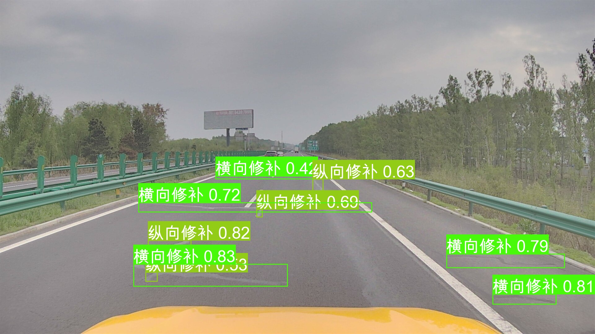
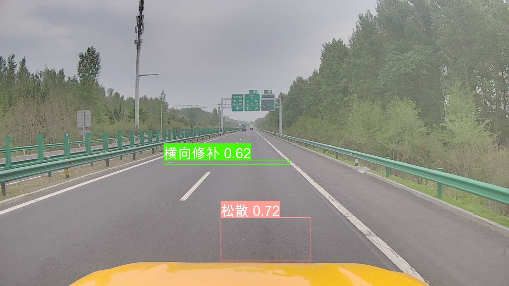

<div align="center">

# Road Pavement Disease Detection System

**18-class pavement defect detection based on YOLOv5 v7.0 · Training + Desktop App + Web Service + Monitoring Dashboard, all in one**

[](#)
[](https://pytorch.org/)
[](https://github.com/ultralytics/yolov5)
[](#)
[](LICENSE)

[简体中文](README.md) | English

</div>

---

This project is built on the [Ultralytics YOLOv5 v7.0](https://github.com/ultralytics/yolov5) framework and fine-tuned on **5,965 real dashcam pavement images**, detecting **18 classes** of road defects and objects (potholes, cracks, patching, faded lane markings, spilled debris, traffic barrels, etc.). Three ready-to-run application front-ends are included. Trained model weights ship with the repo — clone and detect immediately.

> This README is written for YOLOv5 beginners: environment setup, annotation conversion, training, and running the full detection system are all reproducible step by step.

---

## Detection Showcase

Real dashcam pavement images processed by the bundled `weights/best_fixed.pt` (input 640, ~68 ms per frame on an RTX 4060).

| Multi-target patch detection (9 defects in one frame) | Distant small-target detection (patch band + loose aggregate) |
|:---:|:---:|
|  |  |

> Reproduce with: `python detect.py --weights weights/best_fixed.pt --source your_image.jpg` (see [Inference](#inference))

---

## Table of Contents

- [Key Features](#key-features)
- [Project Structure](#project-structure)
- [Detection Classes](#detection-classes)
- [Installation](#installation)
- [Quick Start](#quick-start)
- [Dataset Preparation (labelme → YOLO)](#dataset-preparation-labelme--yolo)
- [Training](#training)
- [Validation & Metrics](#validation--metrics)
- [Inference](#inference)
- [Running the Detection Systems](#running-the-detection-systems)
- [Export & Deployment](#export--deployment)
- [FAQ](#faq)
- [Acknowledgments & License](#acknowledgments--license)

---

## Key Features

- **18-class pavement defect taxonomy**: real diseases (pothole / crack / loose), patch marks, marking conditions, and road objects/debris — ready for road-inspection workflows
- **Batteries included**: `weights/best_fixed.pt` is bundled with corrected Chinese class names — clone and run
- **Complete data pipeline**: `json2yolo.py` converts labelme annotations to YOLO format in one command; stratified train/valid/test splitting
- **Three front-ends**: PyQt5 desktop app, Flask web service, and monitoring dashboard client
- **Beginner friendly**: full commands, per-parameter explanations, and FAQ covering common errors

## Project Structure

```
YOLOv5-Pavement-Detection/
├── train.py                  # Training entry (official YOLOv5)
├── val.py                    # Validation/evaluation entry (official YOLOv5)
├── detect.py                 # Inference entry (official YOLOv5)
├── export.py                 # Model export (ONNX/TensorRT, etc.)
├── hubconf.py                # torch.hub entry (required by torch.hub.load in Python snippets)
├── requirements.txt          # Python dependencies
├── highway_data.yaml         # Dataset config used by training
├── json2yolo.py              # labelme json → YOLO txt converter
├── zhiti.py                  # Tool to fix class names inside weights (see FAQ)
│
├── models/                   # Network definitions
│   ├── yolov5s.yaml          #   s/n/m/l/x depth variants
│   ├── yolo.py               #   Network construction code
│   └── experimental.py       #   attempt_load and other loaders
│
├── utils/                    # Tooling (data, loss, metrics, plotting)
│   ├── dataloaders.py        #   Dataset loading
│   ├── metrics.py            #   mAP/P/R computation
│   └── plots.py              #   Result visualization
│
├── weights/
│   └── best_fixed.pt         # Trained pavement model (Chinese names fixed)
├── docs/                     # Showcase images for this README
│
├── road_disease_pyqt_main.py # [System A] PyQt5 desktop app
├── win1.py                   #   Desktop UI definition
├── app.py                    # [System B] Flask web service
├── templates/
│   └── index.html            #   Web page (Flask loads from templates/ only)
└── pyqt_client.py            # [System C] Monitoring dashboard client
```

**Beginner notes**

- `train.py / val.py / detect.py / export.py` are the four YOLOv5 entry points: training, evaluation, inference, deployment export
- `models/` defines "what the network looks like"; `utils/` defines "how data is fed and loss is computed" — you rarely need to change them
- Training artifacts go to `runs/train/exp*/` by default; this repo does not include runs, train it yourself to regenerate

## Detection Classes

18 classes in total; IDs match `highway_data.yaml`:

| ID | Class | ID | Class | ID | Class |
|:--:|-------|:--:|-------|:--:|-------|
| 0 | Pothole 坑槽 | 6 | Longitudinal patch 纵向修补 | 12 | Round barrel 圆形桶 |
| 1 | Loose aggregate 松散 | 7 | Block patch 块状修补 | 13 | Person 人 |
| 2 | Transverse crack 横向裂纹 | 8 | Network patch 网状修补 | 14 | Square drain cover 方形雨水盖 |
| 3 | Longitudinal crack 纵向裂纹 | 9 | Faded marking 标线模糊 | 15 | Round drain cover 圆形雨水盖 |
| 4 | Alligator crack 网状裂纹 | 10 | Spilled debris 抛洒物 | 16 | Round manhole cover 圆形井盖 |
| 5 | Transverse patch 横向修补 | 11 | Traffic cone 锥形桶 | 17 | Guardrail damage 护栏损坏 |

## Installation

**Recommended**: Windows + Python 3.8~3.11 + CUDA 11.x/12.x (NVIDIA GPU); CPU inference also works (slower).

```bash
# 1. Create a virtual environment (conda example)
conda create -n yolov5 python=3.9 -y
conda activate yolov5

# 2. Install dependencies
pip install -r requirements.txt

# 3. (Optional, NVIDIA GPU) install CUDA build of PyTorch, CUDA 11.8 example
pip install torch==2.0.1 torchvision==0.15.2 --index-url https://download.pytorch.org/whl/cu118
```

Verify:

```bash
python -c "import torch; print(torch.__version__, torch.cuda.is_available())"
```

## Quick Start

Trained weights are bundled, so you can detect right after installing dependencies:

```bash
python detect.py --weights weights/best_fixed.pt --source your_pavement_image.jpg
```

Annotated results are saved to `runs/detect/exp*/`.

## Dataset Preparation (labelme → YOLO)

Required dataset layout:

```
highway_label/
├── train/
│   ├── images/   # training images (.jpg)
│   └── labels/   # YOLO label files (.txt, same base name)
├── valid/
│   ├── images/
│   └── labels/
└── jsons/        # raw labelme annotations (archive only, not used in training)
```

**YOLO label format** (one object per line): `class_id center_x center_y width height`, all four coordinates normalized to image size (0~1).

**Steps**:

1. Annotate images with [labelme](https://github.com/wkentaro/labelme); put the generated `.json` files into `highway_label/jsons/`
2. Open `json2yolo.py` and make sure the `name2id` dict covers every label used in your jsons (all 18 classes are preconfigured, plus a built-in typo alias: `纵向裂缝` → `纵向裂纹`)
3. Run the converter:

```bash
python json2yolo.py
# Labels are written to highway_label/labels/, one-to-one with images
```

4. When splitting train/valid/test, prefer **stratified random splitting** (so rare classes also land in the training set); a ratio around 8:1:1 works well

`highway_data.yaml` already contains the paths (relative to the repo root). If your dataset lives elsewhere, edit these two lines:

```yaml
train: ../highway_label/train/images
val:   ../highway_label/valid/images
nc: 18
names: ['坑槽','松散', ...]
```

## Training

### Download pretrained weights

Training from scratch converges slowly; usually fine-tune from the official `yolov5s.pt` (~14 MB). The first `train.py --weights yolov5s.pt` run downloads it into the current directory automatically, or get it manually from [Releases](https://github.com/ultralytics/yolov5/releases/tag/v7.0) and place it where the `--weights` argument points.

### Start training

```bash
python train.py --data highway_data.yaml --weights yolov5s.pt --epochs 100 --batch-size 16 --img 640
```

**Parameter reference (for beginners)**:

| Argument | Meaning |
|----------|---------|
| `--data` | Dataset config file, points to `highway_data.yaml` |
| `--weights` | Pretrained weights to load; `yolov5s.pt` = fine-tune, `''` = from scratch |
| `--cfg` | Network yaml; full from-scratch training needs `--weights '' --cfg models/yolov5s.yaml` |
| `--epochs` | Training epochs; 100~300 recommended for a few thousand images |
| `--batch-size` | Images per batch; 16 for 8 GB VRAM, 32 for 16 GB; lower it on OOM |
| `--img` | Input size 640; use 1280 for many small targets (~4x VRAM) |
| `--device` | `0` = first GPU; `cpu` = force CPU |
| `--name` | Experiment name, output goes to `runs/train/<name>/` |

### Monitor training

- The terminal prints per-epoch losses (box/obj/cls) and P/R/mAP
- TensorBoard: `tensorboard --logdir runs/train`, then open `http://localhost:6006`
- After training, use `runs/train/exp*/weights/best.pt` (best on validation) and `last.pt` (final epoch)

### Resume / extend training

```bash
python train.py --resume        # resume the interrupted run
python train.py --weights runs/train/exp/weights/last.pt --epochs 200  # continue from an old model
```

## Validation & Metrics

```bash
python val.py --data highway_data.yaml --weights weights/best_fixed.pt --img 640
```

| Metric | Meaning |
|--------|---------|
| **P (Precision)** | How many detections are correct (higher = fewer false alarms) |
| **R (Recall)** | How many true objects are detected (higher = fewer misses) |
| **mAP@0.5** | Mean average precision at IoU 0.5, the common overall metric |
| **mAP@0.5:0.95** | Stricter averaged metric, standard in papers/benchmarks |

Confusion matrix, PR curves, and per-class metrics are saved to `runs/val/exp*/`.

## Inference

Command line (images / videos / webcam):

```bash
python detect.py --weights weights/best_fixed.pt --source test.jpg
python detect.py --weights weights/best_fixed.pt --source 0        # live webcam
```

Minimal Python snippet:

```python
import torch
model = torch.hub.load('./', 'custom', path='weights/best_fixed.pt', source='local')
model.conf = 0.35   # confidence threshold
results = model(['test.jpg'])
results.print(); results.save()
```

## Running the Detection Systems

All three systems load `weights/best_fixed.pt`; **run them from the repo root** (model paths are relative).

### System A: PyQt5 Desktop App

```bash
pip install PyQt5
python road_disease_pyqt_main.py
```

Pick a local image in the window, click detect, and defect boxes render in the UI.

### System B: Flask Web Service

```bash
pip install flask flask-cors
python app.py
# Then open http://127.0.0.1:5000 in a browser
```

Upload an image on the web page → server-side inference → annotated result returned.

### System C: Monitoring Dashboard Client

```bash
python pyqt_client.py
```

A standalone inference dashboard that shares result images with the web service through the `shared_results/` directory.

> Drawing Chinese labels relies on the Windows font `C:/Windows/Fonts/msyh.ttc` (Microsoft YaHei); no action needed on Windows, change the font path on other systems.

## Export & Deployment

```bash
python export.py --weights weights/best_fixed.pt --include onnx    # ONNX
python export.py --weights weights/best_fixed.pt --include engine --device 0  # TensorRT
```

After export you can deploy without PyTorch, e.g. via ONNX Runtime in C++/server environments.

## FAQ

**Q1: Class names in my trained model became numbers/English; inference shows no Chinese names.**
A: YOLOv5 may drop class names when saving. Run `python zhiti.py`: point its `model_path` to your `best.pt`; it rewrites the 18 Chinese class names and saves `weights/best_fixed.pt`.

**Q2: `Label image size mismatch` or labels not found.**
A: Check that `images/` and `labels/` have one-to-one file names (same base name, different extensions), images are not corrupted, and `imageWidth/imageHeight` in the json matches the real image.

**Q3: CUDA out of memory.**
A: Lower `--batch-size` or `--img`; or run with `--device cpu` to validate the pipeline first.

**Q4: How does the `--data` path resolve?**
A: Relative paths resolve from the dataset yaml location. `../highway_label/train/images` in `highway_data.yaml` points to a `highway_label` folder sitting next to this repo; adjust if yours is elsewhere.

**Q5: First run is stuck downloading yolov5s.pt.**
A: Download `yolov5s.pt` manually from [v7.0 Releases](https://github.com/ultralytics/yolov5/releases/tag/v7.0) and place it in the repo root (or in `weights/` and use `--weights weights/yolov5s.pt`).

**Q6: `ImportError: cannot import name 'export_formats' from 'export'`.**
A: `export.py` was overwritten/corrupted (typically by a pyuic5 output with the same name). Re-download the official [v7.0 export.py](https://raw.githubusercontent.com/ultralytics/yolov5/v7.0/export.py) to replace it.

**Q7: Web service raises `TemplateNotFound: index.html`.**
A: Flask only reads pages from the `templates/` directory — make sure `index.html` lives in `templates/`, not the repo root.

**Q8: The runs/ directory keeps growing.**
A: It holds training logs, plots, and weight backups. Keep only `weights/best.pt` and delete the rest; the repo `.gitignore` already ignores runs.

## Acknowledgments & License

- Framework: [ultralytics/yolov5](https://github.com/ultralytics/yolov5) v7.0 (GPL-3.0, see [LICENSE](LICENSE))
- Annotation tool: [wkentaro/labelme](https://github.com/wkentaro/labelme)

<div align="center">

If this project helps you, consider giving it a :star: Star

</div>
